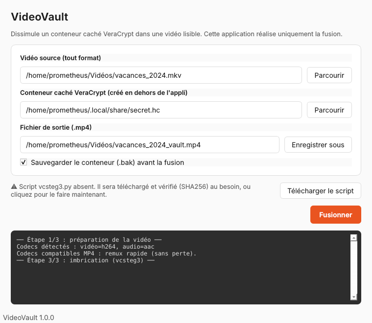

# VideoVault

Outil graphique pour **dissimuler un conteneur caché VeraCrypt dans une vidéo lisible**.

Le fichier produit se lit comme une vraie vidéo **et** se monte comme conteneur
chiffré dans VeraCrypt. L'application réalise **uniquement la fusion** : la
création du conteneur caché et le téléchargement de la vidéo se font en dehors.



## Ce que fait l'application

1. Accepte une vidéo source dans **n'importe quel format** (mkv, avi, mov, webm…)
   et la convertit en MP4 si besoin (remux sans perte, ré-encodage en secours).
2. Sauvegarde le conteneur (`.bak`) puis le copie vers le fichier de sortie.
3. Imbrique la vidéo et le conteneur via le script officiel **vcsteg3.py**.
4. Vérifie que le résultat est lisible.

## Ce qu'elle ne fait pas

- Elle ne crée **pas** le conteneur VeraCrypt. Créez-le d'abord, en **volume
  caché**, avec VeraCrypt.
- Elle ne télécharge **pas** vos vidéos.

## À propos de vcsteg3.py

Le script n'est **pas redistribué** ici. Au premier besoin, l'application le
télécharge depuis la source officielle VeraCrypt et **vérifie son empreinte
SHA-256** avant toute utilisation :

```
c9aaad401b601be7415a973978b6da2fc31f26e58bcf5d4890a3cc1912d86843
```

Un script dont l'empreinte ne correspond pas est refusé.

## Prérequis

- Python 3.10+
- **ffmpeg** et **ffprobe** (`sudo apt install ffmpeg`)
- PySide6 (`pip install -r requirements.txt`)
- VeraCrypt (pour créer le conteneur et le monter ensuite)

## Installation

```bash
git clone https://github.com/<votre-compte>/videovault.git
cd videovault
pip install -r requirements.txt
python3 main.py
```

## Utilisation

1. Créez d'abord un conteneur **caché** avec VeraCrypt (deux mots de passe).
2. Lancez VideoVault.
3. Renseignez : la vidéo source, le conteneur, le fichier de sortie `.mp4`.
4. Cliquez sur **Fusionner**.
5. Montez le fichier produit dans VeraCrypt avec le mot de passe du **volume
   caché**.

## Rappels de sécurité

- Montez **toujours** avec le mot de passe du volume **caché** : la fusion rend
  le volume externe inutilisable.
- N'écrivez **jamais** dans le volume externe, cela écraserait la vidéo.
- Ne conservez pas la vidéo d'origine à côté du résultat (une comparaison
  trahirait la dissimulation).
- Limite technique du format : fichier final sous 4 Go.

## Tests

```bash
python3 tests/run_tests.py
```

## Téléchargements (binaires autonomes)

Les exécutables sont construits par GitHub Actions et publiés sur la page
**Releases** à chaque tag de version :

- `VideoVault-x86_64.AppImage` — Linux, **un seul fichier** (renommable, dissimulable)
- `VideoVault.exe` — Windows, **un seul fichier**

Ces binaires sont **autonomes** : ffmpeg, ffprobe et vcsteg3.py sont embarqués
dedans. Rien d'autre à installer, aucun réseau requis à l'usage. (vcsteg3.py est
téléchargé et vérifié par SHA-256 **au moment de la build**, pas chez vous.)

Pour déclencher une build :

```bash
git tag v1.0.0
git push origin v1.0.0
```

> Note : lancer l'application **depuis les sources** (`python3 main.py`) nécessite,
> lui, un ffmpeg installé sur la machine. Seuls les binaires sont autonomes.

## Licence

GPL-3.0 (voir `LICENSE`). vcsteg3.py n'est pas redistribué : il reste la
propriété du projet VeraCrypt et de ses contributeurs, et est téléchargé depuis
la source officielle avec vérification SHA-256.
